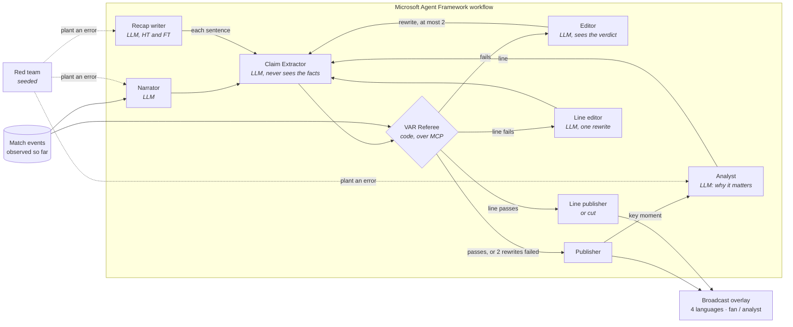

# CaptionVAR

**AI match commentary, checked against the data before it airs.**

[](https://github.com/joelynli0110/captionvar-live-starter/actions/workflows/tests.yml)

A multi-agent system on **Microsoft Foundry** where one agent writes live football captions, another explains why key moments matter, a third writes the half-time and full-time recaps, and a referee written in code checks every claim they make against the match events before anything reaches the viewer. Built for the Microsoft × Premier League *Inside the Game* hackathon.

**[Open the live demo](https://joelynli0110.github.io/captionvar-live-starter/)**. It needs no sign-in and opens just before the 24th minute of a synthetic match, playing at 8× speed: the narrator calls the first goal 0-2, and the VAR check stops it on screen and airs the corrected 0-1. **Production** shows the check as it happens; **Viewer feed** shows only what airs. Add `?at=77` to jump to a minute, or `?intro=1` for the team sheet of agents.


## The problem

A language model can describe a match well and still get a fact wrong: the wrong scorer, a 0-2 that is really 0-1, a sprint of 36 km/h that was 35. Viewers can't spot these, and a broadcaster can't air them. Asking a second model whether the first was right only moves the problem.

## What CaptionVAR does

Every caption goes through a VAR check before it airs. The model writes the caption, but code decides whether it is true, using only the events recorded up to that moment.

| Verdict | When | What airs |
|---|---|---|
| **Verified** | Every claim matches the events | The caption as written |
| **Trimmed** | The main claim holds, but a detail is false or can't be checked | The caption with that detail removed |
| **Withheld** | The main claim is false | A corrected rewrite that passed the same check, or a caption built from the data |

After a goal, a big chance, a pressing spell or a possession report, an **Analyst** adds one line on **why it matters**, from running numbers: shots and xG so far, minutes since the last shot on target, possession over the last 10 minutes, a player's match totals. At half-time and full time a **Recap writer** sums up the half. These lines go through the same check, with one difference: a caption always airs (corrected if need be), but a line of context or a recap sentence that still fails after one rewrite is cut.

In the VAR room (right-hand panel) you can open any caption and see:
- the false words struck through, with the reason;
- whether the red team planted the error or the narrator made it on its own (checked by hand);
- each draft, in order, and how long the caption took to air;
- the line on why it matters, with its own verdict;
- the event IDs behind each verdict, drawn on the pitch.

The **Recaps** tab shows each recap sentence by sentence, with any the check cut.

## Results

**Against simpler set-ups.** Evaluation v1, run on 24–25 October 2026 (UTC): five synthetic matches on Foundry (gpt-4.1-mini), 195 captions, with the referee code as it was at that run. Each set-up checks the same narrator drafts:

| | Planted errors on air | Narrator's own false details on air | Cost per match |
|---|---|---|---|
| Narrator alone | 61 / 61 | 11 / 11 | ≈ $0.01 |
| Same model checks itself | 0 / 61 | 8 / 11 | ≈ $0.02 |
| Second LLM as judge + editor | 0 / 61 | 7 / 11 | ≈ $0.025 |
| **CaptionVAR** | **1 / 61** ¹ | **0 / 11** | ≈ $0.10 |

¹ A planted superlative the extractor did not report as a claim ("could've been the best strike attempt of the entire league season"). A code guard (`checkSweepingClaims`) was added after this run. Applied to the recorded texts, it flags this draft and the other planted superlatives, and nothing else. The five matches have not been re-run with it, so the table shows what v1 aired, not a zero.

These costs cover the captions; the Analyst and the recaps add about $0.08 a match.

Given the facts, an LLM catches the errors you plant, but it misses the ones the model makes on its own. Those sit in the build-up ("loses possession under pressure from Sow" when Sow made no press), and a code referee looks up every one. The 61 are the red team's 62 instructions less one the narrator ignored; the 11 are the narrator's own errors confirmed by hand among 39 the referee flagged. Every number here is recomputed from the raw reports by `agents/summarise_baselines.py` and published in [`baselines-summary.json`](public/traces/baselines-summary.json) (`reported`, next to the purely automatic counts), with each hand check in [`docs/eval-adjudication.json`](docs/eval-adjudication.json). Method, examples and caveats: [docs/EVALUATION.md](docs/EVALUATION.md).

**The demo match.** A seeded red team told the agents to slip a specific error into about a third of what they wrote. The extractor and the referee were not told which.

| | |
|---|---|
| Captions written | 40 over 90 minutes |
| Planted errors in captions caught | **15 of 15**, none on air |
| Lines on why a moment matters | 19 written, 18 aired (7 after a rewrite), 1 cut |
| Planted errors in those lines caught | **5 of 5**; told 3 more times, the Analyst wrote a true line instead |
| Recap sentences (half-time, full time) | 12 written, 12 aired (1 after a rewrite); the planted wrong total was caught |
| The narrator's own errors the referee flagged | 6, checked by hand: 1 real ("under pressure from Marsh", his own teammate), trimmed; 5 true details misread by the extractor |
| Time to air, per caption | median **3.7 s**, p95 7.1 s; 2.9 s when the first draft passes. The referee itself: about 3 ms |
| Time to air, line on why it matters | median 10 s after the moment |
| Model calls, cost and time | 188 calls, **≈ $0.18**, 6 min 42 s for the whole match |

Times leave out waits on our own rate limiter, which paces calls for a small deployment quota. The full run is published in [`public/traces/foundry-demo.json`](public/traces/foundry-demo.json), and the demo replays it at the recorded pace. Every draft, verdict, timing and evidence ID is in that file, and the hand check is in [`docs/demo-adjudication.json`](docs/demo-adjudication.json).

**A cheaper model.** The referee is code, so the model behind the agents is a cost choice, not a safety one. The same match and red-team plan, run with gpt-4.1-nano instead of gpt-4.1-mini:

| | gpt-4.1-mini | gpt-4.1-nano |
|---|---|---|
| Planted errors in captions caught | 15 / 15 | 15 / 15 |
| False facts on air (aired captions checked by hand) | 0 | 0 of 21 written by the model |
| First drafts that passed the check | 22 / 40 | 6 / 40 |
| Captions that aired from the data, because no rewrite passed | 0 | 19 / 40 |
| Lines on why it matters aired | 18 / 19 | 2 / 19 |
| Time to air, median | 3.7 s | 6.9 s |
| Cost for the match | ≈ $0.18 | ≈ $0.07 |

The cheaper model fails the check far more often, so more captions fall back to plain ones built from the data and most lines of context are cut. In this match no planted error aired with either model, and every caption nano wrote that aired was checked by hand and is true. One match is a small sample. Details: [docs/EVALUATION.md](docs/EVALUATION.md#a-cheaper-model).

## How it works



What each agent does:
- **Narrator** (LLM): writes one broadcast line from the moment's facts and the last few actions.
- **Claim Extractor** (LLM with structured output): turns the line into typed claims and records the exact words behind each claim. It sees only the caption and the squad lists, never the facts, so it can't quietly fix a claim before the check.
- **Referee** (code): checks each claim against the events, with explicit tolerances, and cites the event IDs it used. The browser and the unit tests run this same code.
- **Editor** (LLM): gets the verdict on each claim and the true facts, and rewrites the caption. Each rewrite goes back through the same extraction and check.
- **Publisher**: airs the first version that passes. If none passes, it airs a caption built straight from the data. For key moments it then hands the aired caption to the Analyst.
- **Analyst** (LLM): writes one line on why the moment matters from the running numbers behind it.
- **Recap writer** (LLM with structured output): writes the half-time and full-time recaps as separate sentences, each checked on its own.
- **Line editor** (LLM): rewrites a failed line or recap sentence once; if it still fails, it is cut.

The referee is an **MCP server** ([`scripts/referee-mcp.mjs`](scripts/referee-mcp.mjs)): the workflow calls its `check_caption` tool and the views each agent may see over MCP, and every call is its own span in the trace. Any MCP client can use the same tools; [`.vscode/mcp.json`](.vscode/mcp.json) adds them to GitHub Copilot agent mode in VS Code.

Rules the referee enforces:
- **Fail closed.** A caption with no claim that can be checked does not air.
- **Every named player must be backed.** A name in the caption must belong to a claim that passed.
- **Every caption must report its moment.** A true sentence that leaves out the scorer, the booked player or the sprint speed is withheld.
- **No comparisons beyond the match.** "The best strike of the season" is flagged even if the extractor misses it.
- **Build-up details are checked too.** "After Morita won it back" is looked up in the events of the previous two minutes.
- **No future data.** The referee sees only events up to the moment being captioned, or the end of the half for a recap.
- **Lines of context may interpret, not invent.** "The press is pinning them back" is allowed as framing next to at least one checked number; a line with no checked fact, or a false one, does not air.

Claims it can check: scorer, assist, score, whether the goal came from a press, the scorer's goal tally, shooter, shot outcome, xG, booked player, substitutions, top speed, distance covered, possession, pass accuracy, recoveries in a time window, the recent actions behind a moment (foul, tackle, pass, carry, press, ball won, ball lost, shot, save, block), and for context and recaps: team and player totals so far (shots, shots on target, xG, corners, fouls, bookings, final-third recoveries, goals, assists, passes), minutes since a team's previous shot, shot on target or goal, possession over the last 10 minutes, and earlier goals and bookings.

More detail: [docs/AGENTS.md](docs/AGENTS.md).

## The match data

No licensed data is used. A seeded simulator generates a full, realistic 90 minutes, which for the demo seed is 2,257 events:
- passes, carries, pressures, tackles and recoveries;
- shots with xG, saves and blocks;
- set pieces, cards and substitutions;
- sprint speeds and distance covered.

Events link to their causes: a recovery records the pressure that caused it, and a goal records its shot and assist. That is what lets the referee check "from a press" or "after Morita won it back". Totals are calibrated against top-flight per-team averages, and every match passes an invariant validator. The match is replayed as a live feed.

Details: [docs/SYNTHETIC_DATA.md](docs/SYNTHETIC_DATA.md).

## Viewer features

- **The VAR replay.** When a check changes a caption, the picture freezes, runs back to the first piece of evidence and plays the move again, slowed, while the false words are struck. Turn on **Sound** for the cue tones; they are synthesised in the browser, with no recorded audio.
- **Beat the VAR** (or open with `?game=1`). Each caption waits on screen before its check. Tap the words you think are false, lock in your call, and see it scored against the referee's verdict, claim by claim.
- **Red team slider.** Set what share of captions are planted wrong, from none to all. The match is then replayed with the in-browser test narrator, and the same referee code checks it in your browser, so you can see the checks hold as the error rate rises. The Foundry run itself stays as recorded.
- **Commentary voice.** Turn on **Voice** and the browser reads each caption aloud in the caption language, using its built-in speech synthesis. It is given only the caption after its VAR check, then the line of context and the recaps, so a draft the referee rejected is never spoken.
- **Two fans.** One checked caption on a split screen: a Northbridge fan in English and a Riverside fan in Chinese, each written from the same verified facts.
- **Player tags at fixed thresholds**, straight from the event feed (on screen: every shot, standout passes, and everything for a player you follow): a sprint of 33 km/h or more, a completed pass of 40 m or more or with difficulty 60/100 or more, every shot with its xG and speed, and distance milestones. `npm run overlays` writes them as a timed, machine-readable overlay feed (JSON lines) for a graphics renderer.
- **The move in progress and both teams' shape** on the pitch: every touch of the current possession, and each player at his last touch (positions are not tracked, so these fade with age).
- **One thing at a time.** During a VAR check everything but the pitch steps back. A first-time viewer gets one hint at a time: open the record of the check, then go to the next VAR call. Speed, language and goal jumps are in the settings menu; the play-along tools fold away under **Play along**. Pass quality (long and difficult passes, fastest shot) is in the analyst panel.

- **Fan or analyst** wording, with neutral or partisan framing.
- **Follow a player**: the pitch traces their recent actions, and a card shows their live numbers.
- **English, Spanish, German and Chinese.** The analyst view and the other languages are built from the verified facts, not machine-translated from the caption, so they can't reintroduce an error.
- A **timeline** of final-third pressure per minute, with goals, cards and VAR interventions marked. Drag it to move through the match.

## Run it

**The demo** needs Node.js 22 or later:

```bash
npm install
npm test          # 44 tests: simulator, referee, context lines and recaps, rendering, Beat the VAR
npm run dev       # http://127.0.0.1:5173/captionvar-live-starter/
```

Every push and pull request runs both suites in GitHub Actions ([`tests.yml`](.github/workflows/tests.yml)): the Node tests and build, and the agent workflow offline with the referee over MCP.

**The agents on Foundry** need Python 3.11+, a Foundry project with a model deployment, and `az login`:

```powershell
python -m venv .venv; .\.venv\Scripts\Activate.ps1
pip install -r agents\requirements.txt
$env:FOUNDRY_PROJECT_ENDPOINT = "<project endpoint from the Foundry portal>"
$env:FOUNDRY_MODEL = "gpt-4.1-mini"
python agents\run_match.py --out public\traces\foundry-demo.json --rpm 30
```

Add `--trace` to send one OpenTelemetry trace per caption to the Application Insights resource connected to your Foundry project. In Application Insights, **Transaction search** then opens any caption as one timeline of every agent call, with the referee's verdict and evidence on its span ([setup](docs/AGENTS.md#trace-it-in-foundry)). `--offline` runs the same workflow with a scripted model, with no Azure account and no cost. `pytest agents/tests` runs the 18 workflow tests the same way. `--no-insights` and `--no-recaps` skip the Analyst and the recaps.

To replay a run you made, put it in `public/traces/` and open the demo with `?trace=<file>.json`. `?at=77`, `?at=HT` or `?at=FT` starts playback at that point.

**The referee over MCP** needs only Node.js: `node scripts/referee-mcp.mjs` serves it on stdio. In VS Code, open the repository and start `captionvar-referee` from `.vscode/mcp.json`; Copilot agent mode can then check a caption with `check_caption`.

## Repository layout

```text
src/sim/         seeded match simulator, stats, live feed, validator
src/broadcast/   referee (verify.js, statements.js), claim binding, context and recap facts, agent packets, rendering
src/ui/          pitch, broadcast overlay, VAR room, timeline (React)
agents/          Microsoft Agent Framework workflow, prompts, run_match.py
scripts/         match generator, calibration, referee-mcp.mjs (the referee as an MCP server), factbox
public/traces/   the published Foundry run
docs/            agent design, data schema, media
```

## Limitations

- **The match is synthetic.** Clubs, players and events are fictional, and positions are generated, not tracked. The design assumes an event feed with stable IDs, which official data providers supply, but it has not been run on one.
- **The referee covers the claim types listed above.** Anything else ("their finest chance all season") is reported as uncheckable and trimmed, so a true remark can be dropped. That is the intended trade-off.
- **The demo replays a recorded run.** The agents ran on Foundry and the site replays that trace, so no API key ships with the page. Run `run_match.py` to generate a new one.
- **Strict, at the cost of some true detail.** The extractor sometimes ties a build-up action to the wrong player ("X under pressure from Y"). The referee then flags a true detail and the editor trims it. In the five-match comparison this cost 28 true details in 195 captions: true colour lost, nothing false added.
- **Lines of context have the same extractor weakness.** In the demo run, 3 of 19 lines were rewritten over a true detail the extractor misread (a score the wrong way round, a "none after pressing" read as a press). The rewrites aired, and no planted error did.
- **The comparison is small.** It covers 5 matches, one model and 11 of the narrator's own errors. The direction is clear, but it is not a benchmark.
- **English drafts only.** The agents write in English, and the other languages are rendered from the checked facts. Lines of context are free text, so they show in English only.

## License

[MIT](LICENSE). No Premier League footage, data, club names or crests are used.
