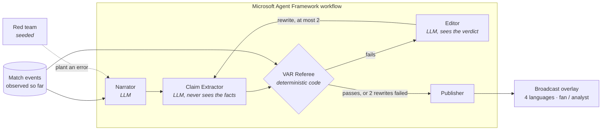

# CaptionVAR

**AI match commentary, checked against the data before it airs.**

A multi-agent system on **Microsoft Foundry** where one agent writes live football captions, a second reports what they claim, and a referee written in code checks every claim against the match events before anything reaches the viewer. Built for the Microsoft × Premier League *Inside the Game* hackathon.

**[Open the live demo](https://joelynli0110.github.io/captionvar-live-starter/)**. It needs no sign-in and opens at 72:30 of a synthetic match, playing at 8× speed.


## The problem

A language model can describe a match well and still get a fact wrong: the wrong scorer, a 0-2 that is really 0-1, a sprint of 36 km/h that was 35. Viewers can't spot these, and a broadcaster can't air them. Asking a second model whether the first was right only moves the problem.

## What CaptionVAR does

Every caption goes through a VAR check before it airs. The model writes the caption, but code decides whether it is true, using only the events recorded up to that moment.

| Verdict | When | What airs |
|---|---|---|
| **Verified** | Every claim matches the events | The caption as written |
| **Trimmed** | The main claim holds, but a detail is false or can't be checked | The caption with that detail removed |
| **Withheld** | The main claim is false | A corrected rewrite that passed the same check, or a caption built from the data |

In the VAR room (right-hand panel) you can open any caption and see:
- the false words struck through, with the reason;
- each draft, in order;
- the event IDs behind each verdict, drawn on the pitch.

## Results

**Against simpler set-ups.** Five matches on Foundry (gpt-4.1-mini), 195 captions. Each set-up checks the same narrator drafts:

| | Planted errors on air | Narrator's own false details on air | Cost per match |
|---|---|---|---|
| Narrator alone | 55 / 55 | 11 / 11 | ≈ $0.01 |
| Same model checks itself | 0 / 55 | 8 / 11 | ≈ $0.02 |
| Second LLM as judge + editor | 0 / 55 | 7 / 11 | ≈ $0.025 |
| **CaptionVAR** | **0 / 55** | **0 / 11** | ≈ $0.10 |

Given the facts, an LLM catches the errors you plant, but it misses the ones the model makes on its own. Those sit in the build-up ("loses possession under pressure from Sow" when Sow made no press), and a code referee looks up every one. Every own-error case was checked by hand against the raw events. Method, examples and caveats: [docs/EVALUATION.md](docs/EVALUATION.md).

**The demo match.** A seeded red team told the narrator to slip a specific error into about a third of the captions. The extractor and the referee were not told which.

| | |
|---|---|
| Captions written | 40 over 90 minutes |
| Planted errors caught | **15 of 15** |
| Captions with a false fact on air | **0** |
| Aired as first written / after an editor rewrite / from the data | 24 / 15 / 1 |
| Model calls, cost and time | 116 calls, **≈ $0.09**, 4 min 13 s |

The full run is published in [`public/traces/foundry-demo.json`](public/traces/foundry-demo.json), and the demo replays it. Every draft, verdict and evidence ID is in that file.

## How it works



What each agent does:
- **Narrator** (LLM): writes one broadcast line from the moment's facts and the last few actions.
- **Claim Extractor** (LLM with structured output): turns the line into typed claims and records the exact words behind each claim. It sees only the caption and the squad lists, never the facts, so it can't quietly fix a claim before the check.
- **Referee** (code): checks each claim against the events, with explicit tolerances, and cites the event IDs it used. The browser and the unit tests run this same code.
- **Editor** (LLM): gets the verdict on each claim and the true facts, and rewrites the caption. Each rewrite goes back through the same extraction and check.
- **Publisher**: airs the first version that passes. If none passes, it airs a caption built straight from the data.

Rules the referee enforces:
- **Fail closed.** A caption with no claim that can be checked does not air.
- **Every named player must be backed.** A name in the caption must belong to a claim that passed.
- **Every caption must report its moment.** A true sentence that leaves out the scorer, the booked player or the sprint speed is withheld.
- **No comparisons beyond the match.** "The best strike of the season" is flagged even if the extractor misses it.
- **Build-up details are checked too.** "After Morita won it back" is looked up in the events of the previous two minutes.
- **No future data.** The referee sees only events up to the moment being captioned.

Claims it can check: scorer, assist, score, whether the goal came from a press, the scorer's goal tally, shooter, shot outcome, xG, booked player, substitutions, top speed, distance covered, possession, pass accuracy, recoveries in a time window, and the recent actions behind a moment (foul, tackle, pass, carry, press, ball won, ball lost, shot, save, block).

More detail: [docs/AGENTS.md](docs/AGENTS.md).

## The match data

No licensed data is used. A seeded simulator generates a full, realistic 90 minutes, which for the demo seed is 2,257 events:
- passes, carries, pressures, tackles and recoveries;
- shots with xG, saves and blocks;
- set pieces, cards and substitutions;
- sprint speeds and distance covered.

Events link to their causes: a recovery records the pressure that caused it, and a goal records its shot and assist. That is what lets the referee check "from a press" or "after Morita won it back". Totals are calibrated against top-flight per-team averages, and every match passes an invariant validator. The match is replayed as a live feed.

Details: [docs/SYNTHETIC_DATA.md](docs/SYNTHETIC_DATA.md).

## Viewer features

- **Fan or analyst** wording, with neutral or partisan framing.
- **Follow a player**: the pitch traces their recent actions, and a card shows their live numbers.
- **English, Spanish, German and Chinese.** The analyst view and the other languages are built from the verified facts, not machine-translated from the caption, so they can't reintroduce an error.
- A **timeline** of final-third pressure per minute, with goals, cards and VAR interventions marked. Drag it to move through the match.

## Run it

**The demo** needs Node.js 22 or later:

```bash
npm install
npm test          # 32 tests: simulator, referee, rendering
npm run dev       # http://127.0.0.1:5173/captionvar-live-starter/
```

**The agents on Foundry** need Python 3.11+, a Foundry project with a model deployment, and `az login`:

```powershell
python -m venv .venv; .\.venv\Scripts\Activate.ps1
pip install -r agents\requirements.txt
$env:FOUNDRY_PROJECT_ENDPOINT = "<project endpoint from the Foundry portal>"
$env:FOUNDRY_MODEL = "gpt-4.1-mini"
python agents\run_match.py --out public\traces\foundry-demo.json --rpm 30
```

Add `--trace` to send one OpenTelemetry trace per caption to the Application Insights resource connected to your Foundry project. You can then step through every agent call and the referee's verdict in the portal ([setup](docs/AGENTS.md#trace-it-in-foundry)). `--offline` runs the same workflow with a scripted model, with no Azure account and no cost. `pytest agents/tests` runs the 7 workflow tests the same way.

## Repository layout

```text
src/sim/         seeded match simulator, stats, live feed, validator
src/broadcast/   referee (verify.js), claim binding, agent packets, caption rendering
src/ui/          pitch, broadcast overlay, VAR room, timeline (React)
agents/          Microsoft Agent Framework workflow, prompts, run_match.py
scripts/         match generator, calibration, factbox (the referee as a service for Python)
public/traces/   the published Foundry run
docs/            agent design, data schema, media
```

## Limitations

- **The match is synthetic.** Clubs, players and events are fictional, and positions are generated, not tracked. The design assumes an event feed with stable IDs, which official data providers supply, but it has not been run on one.
- **The referee covers the claim types listed above.** Anything else ("their finest chance all season") is reported as uncheckable and trimmed, so a true remark can be dropped. That is the intended trade-off.
- **The demo replays a recorded run.** The agents ran on Foundry and the site replays that trace, so no API key ships with the page. Run `run_match.py` to generate a new one.
- **Strict, at the cost of some true detail.** The extractor sometimes ties a build-up action to the wrong player ("X under pressure from Y"). The referee then flags a true detail and the editor trims it. In the five-match comparison this cost 28 true details in 195 captions, and no false ones aired.
- **The comparison is small.** It covers 5 matches, one model and 11 of the narrator's own errors. The direction is clear, but it is not a benchmark.
- **English drafts only.** The agents write in English, and the other languages are rendered from the checked facts.

## License

[MIT](LICENSE). No Premier League footage, data, club names or crests are used.
